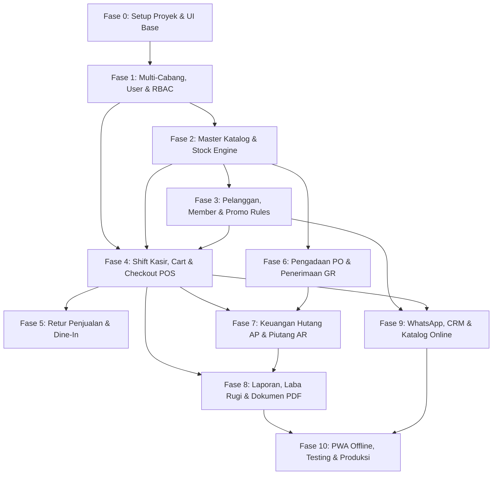

# Panduan Lengkap Rewrite Sistem Point of Sales (POS) dari Nol

Dokumen ini berisi panduan teknis komprehensif, arsitektur, dan langkah-langkah implementasi fitur demi fitur dari awal (*step-by-step from scratch*) untuk membangun ulang sistem **Point of Sales (POS)** enterprise modern dengan stack:
- **Backend:** Laravel 13 (PHP 8.3+)
- **Frontend:** Inertia.js 3.0 + React 19, Vite 5
- **Styling:** Tailwind CSS 3
- **Database:** MySQL (Produksi) / SQLite In-Memory (Pengujian)
- **Role & Permission:** Spatie Laravel Permission
- **Payment & Integrasi:** Midtrans, Xendit, Thermal ESC/POS, WhatsApp Service

---

## Daftar Isi

1. [Prinsip Arsitektur Utama](#1-prinsip-arsitektur-utama)
2. [Peta Alur Dependensi Fitur](#2-peta-alur-dependensi-fitur)
3. [Fase 0: Fondasi Proyek & Setup Environment](#fase-0-fondasi-proyek--setup-environment)
4. [Fase 1: Multi-Cabang, Pengguna & RBAC](#fase-1-multi-cabang-pengguna--rbac)
5. [Fase 2: Master Katalog, Multi-Satuan & Stock Mutation Engine](#fase-2-master-katalog-multi-satuan--stock-mutation-engine)
6. [Fase 3: Pelanggan, Member Tiers & Pricing/Promo Engine](#fase-3-pelanggan-member-tiers--pricingpromo-engine)
7. [Fase 4: Operasional Kasir & Engine Checkout POS](#fase-4-operasional-kasir--engine-checkout-pos)
8. [Fase 5: Purna Jual, Retur Penjualan & Dine-In](#fase-5-purna-jual-retur-penjualan--dine-in)
9. [Fase 6: Pengadaan & Rantai Pasok (PO, GR & Retur Supplier)](#fase-6-pengadaan--rantai-pasok-po-gr--retur-supplier)
10. [Fase 7: Manajemen Keuangan Lite (Hutang & Piutang)](#fase-7-manajemen-keuangan-lite-hutang--piutang)
11. [Fase 8: Laporan, Analitik Bisnis & Dokumen PDF](#fase-8-laporan-analitik-bisnis--dokumen-pdf)
12. [Fase 9: Omnichannel, WhatsApp Gateway & Integrasi Pembayaran](#fase-9-omnichannel-whatsapp-gateway--integrasi-pembayaran)
13. [Fase 10: PWA Offline, Testing Otomatis & Hardening Produksi](#fase-10-pwa-offline-testing-otomatis--hardening-produksi)

---

## 1. Prinsip Arsitektur Utama

1. **Multi-Cabang Sejak Awal (*Day-1 Location Isolation*)**
   - Stok fisik tidak disimpan di tabel master `products`, melainkan di pivot `product_warehouse` (`product_id` + `warehouse_id`).
   - Setiap pengguna kasir/staf diikat ke satu cabang (`warehouse_id`). Pengguna kantor pusat (HQ) memiliki `warehouse_id = null` dan dapat melihat laporan konsolidasi atau berganti cabang lewat *branch switcher*.
2. **Histori Mutasi Stok Tak Terbantahkan (*Immutable Stock Ledger*)**
   - Tidak boleh ada operasi yang menambah/mengurangi kolom stok secara langsung tanpa mencatat entri riwayat di `stock_mutations`. Setiap perubahan wajib menyertakan tipe mutasi, referensi dokumen, dan user yang mengeksekusi.
3. **Dedicated Service Layer**
   - Controller wajib tetap ramping (*skinny controllers*). Semua kalkulasi kompleks (PPN, diskon bertingkat, promo bundle, rekonsiliasi kas kasir, aging piutang, format ESC/POS) diisolasi di direktori `app/Services/`.
4. **Keamanan Transaksional & Database Atomik**
   - Seluruh mutasi kasir dan inventaris dibungkus `DB::transaction()` dengan proteksi *pessimistic locking* (`lockForUpdate()`) untuk mencegah *race condition* stok negatif saat banyak kasir checkout bersamaan.
   - Aksi sensitif (ubah password, hapus user, edit setting payment) diwajibkan melewati proteksi `step_up` (re-autentikasi).

---

## 2. Peta Alur Dependensi Fitur



---

## Fase 0: Fondasi Proyek & Setup Environment

### 1. Inisialisasi Proyek
```bash
# Buat project Laravel baru
composer create-project laravel/laravel point-of-sales
cd point-of-sales

# Install Laravel Breeze dengan stack Inertia React
composer require laravel/breeze --dev
php artisan breeze:install react --ssr=false

# Install dependencies backend
composer require spatie/laravel-permission barryvdh/laravel-dompdf maatwebsite/excel midtrans/midtrans-php xendit/xendit-php

# Install dependencies frontend
npm install @tabler/icons-react react-hot-toast sweetalert2 chart.js react-chartjs-2 clsx tailwind-merge
```

### 2. Konfigurasi Tema Tailwind CSS (`tailwind.config.js`)
Konfigurasikan palet warna konsisten:
- `primary`: Indigo (`#6366f1` / `#4f46e5`)
- `accent`: Cyan (`#06b6d4`)
- `success`: Emerald (`#10b981`)
- `warning`: Amber (`#f59e0b`)
- `danger`: Rose (`#f43f5e`)

### 3. Struktur Layout Dasar (`resources/js/Layouts/`)
1. **`DashboardLayout.jsx`**: Layout admin/manajer (Sidebar menu, topbar dengan profil user, lonceng notifikasi, dan branch switcher untuk akun HQ).
2. **`POSLayout.jsx`**: Layout khusus layar kasir (Layar penuh responsif, status shift kasir aktif, grid produk cepat, panel cart transaksional).
3. **`GuestLayout.jsx`**: Halaman login dan otentikasi.
4. **`AuthenticatedLayout.jsx`**: Halaman akun dan preferensi profil pengguna.

---

## Fase 1: Multi-Cabang, Pengguna & RBAC

### 1. Skema Database
- **Tabel `warehouses`**:
  - `id`, `code` (string, unique), `name` (string), `type` (enum: `main`, `branch`, `warehouse`).
  - `address` (text), `phone` (string), `is_active` (boolean, default true), `sort_order` (integer).
  - Kolom jam buka & kanal katalog: `catalog_delivery_enabled`, `catalog_pickup_enabled`, `is_24_hours`, `open_time`, `close_time`, `operating_days` (json), `is_temporarily_closed`, `closure_reason`, `reopen_date`.
- **Tabel `users` (Update)**:
  - Tambah kolom `warehouse_id` (foreignId nullable, cascadeOnDelete). *Catatan: Jika null = akun Kantor Pusat / Super Admin*.
  - `phone`, `is_active`, `last_login_at`.
- **Tabel Spatie Permission**:
  - Menjalankan migrasi `roles`, `permissions`, `model_has_roles`, `model_has_permissions`, `role_has_permissions`.
- **Tabel `audit_logs`**:
  - `id`, `user_id` (nullable), `warehouse_id` (nullable), `action` (string: create/update/delete/login), `model_type` (string), `model_id` (unsignedBigInteger), `old_values` (json nullable), `new_values` (json nullable), `ip_address`, `user_agent`, `created_at`.
- **Tabel `settings`**:
  - `key` (string, unique), `value` (text nullable), `group` (string, misal: `general`, `invoice`, `pos`, `tax`).

### 2. Backend Implementation
- **Model `Warehouse.php`**:
  - Relasi: `hasMany(User::class)`, `hasMany(CashierShift::class)`, `belongsToMany(Product::class, 'product_warehouse')`.
- **Model `User.php`**:
  - Trait: `HasRoles`.
  - Method `isHQ()`: `return is_null($this->warehouse_id);`.
- **Service `AuditLogService.php`**:
  - Method `log(string $action, Model $model, ?array $old = null, ?array $new = null)`.
- **Middleware Keamanan**:
  - `EnsureBotGuard`: Honeypot input dan timer minimal isi form (2 detik).
  - `EnsureRecentPasswordConfirmation` (`step_up`): Meminta konfirmasi password untuk aksi kritis dengan sesi 15 menit.
  - `EnforceAbsoluteSessionLifetime`: Logout paksa setelah durasi sesi berakhir.
- **`HandleInertiaRequests.php`**:
  - Bagikan props global: `auth.user`, `auth.permissions`, `activeWarehouse`, `activeShift`, `storeProfile`.

---

## Fase 2: Master Katalog, Multi-Satuan & Stock Mutation Engine

### 1. Skema Database
- **Tabel `categories`**: `id`, `name`, `slug`, `image`, `description`.
- **Tabel `units`**: `id`, `name` (Pcs, Box, Dus, Kg), `short_name`.
- **Tabel `product_units`**:
  - `id`, `product_id`, `unit_id`, `conversion_factor` (decimal 10,4), `price` (decimal 14,2), `is_base_unit` (boolean).
- **Tabel `products`**:
  - `id`, `category_id`, `barcode` (nullable, indexed), `sku` (unique), `name`, `slug`, `image`, `buy_price`, `sell_price`, `min_stock`, `has_batch` (boolean), `tax_rate` (decimal, default 0).
- **Tabel pivot `product_warehouse`**:
  - `id`, `product_id`, `warehouse_id`, `stock` (decimal 12,2, default 0), `rack_location` (string nullable).
  - Unique constraint: `['product_id', 'warehouse_id']`.
- **Tabel `stock_mutations` (Pusat Audit Stok)**:
  - `id`, `warehouse_id`, `product_id`, `user_id`, `type` (enum: `initial`, `pos_sale`, `sale_return`, `purchase_receive`, `supplier_return`, `transfer_out`, `transfer_in`, `opname_adjustment`), `qty` (decimal 12,2), `stock_before` (decimal 12,2), `stock_after` (decimal 12,2), `reference_type` (nullable), `reference_id` (nullable), `notes` (text nullable), `created_at`.
- **Tabel `stock_transfers` & `stock_transfer_items`**:
  - Transfer antar cabang: `source_warehouse_id`, `destination_warehouse_id`, `status` (`draft`, `in_transit`, `completed`, `cancelled`).
- **Tabel `stock_opnames` & `stock_opname_items`**:
  - Formulir penyesuaian stok fisik vs sistem: `system_stock`, `physical_stock`, `difference`.
- **Tabel `product_batches`**:
  - `id`, `product_id`, `warehouse_id`, `batch_number`, `expiry_date`, `stock`, `cost_price`.

### 2. Logika Bisnis & Service Layer
- **`StockMutationService.php`**:
  ```php
  public function record(
      int $warehouseId,
      int $productId,
      float $qty,
      string $type,
      ?string $refType = null,
      ?int $refId = null,
      ?string $notes = null
  ): StockMutation {
      // 1. Lock baris stok di product_warehouse
      $pw = ProductWarehouse::where('warehouse_id', $warehouseId)
          ->where('product_id', $productId)
          ->lockForUpdate()
          ->firstOrFail();

      $before = $pw->stock;
      $after = $before + $qty; // Qty bisa negatif jika barang keluar

      if ($after < 0 && !config('pos.allow_negative_stock')) {
          throw new InsufficientStockException("Stok tidak mencukupi.");
      }

      $pw->update(['stock' => $after]);

      // 2. Tulis riwayat mutasi
      return StockMutation::create([
          'warehouse_id' => $warehouseId,
          'product_id' => $productId,
          'user_id' => auth()->id(),
          'type' => $type,
          'qty' => $qty,
          'stock_before' => $before,
          'stock_after' => $after,
          'reference_type' => $refType,
          'reference_id' => $refId,
          'notes' => $notes,
      ]);
  }
  ```
- **`UnitConversionService.php`**: Menghitung konversi kuantitas dari satuan beli/jual ke satuan dasar inventory.
- **`BatchService.php`**: Mengalokasikan batch produk keluar berdasarkan FEFO (*First Expired, First Out*).

---

## Fase 3: Pelanggan, Member Tiers & Pricing/Promo Engine

### 1. Skema Database
- **Tabel `customers`**:
  - `id`, `code`, `name`, `phone` (unique, nullable), `email`, `address`, `credit_limit` (decimal 14,2, default 0), `due_days` (integer, default 0), `loyalty_points` (integer, default 0), `tier` (enum: `regular`, `silver`, `gold`, `platinum`).
- **Tabel `loyalty_point_histories`**:
  - `customer_id`, `transaction_id`, `type` (`earn`, `redeem`, `adjustment`), `points`, `balance_after`.
- **Tabel `customer_vouchers`**:
  - `code`, `customer_id` (nullable jika voucher publik), `type` (`fixed`, `percent`), `amount`, `min_spend`, `valid_until`, `is_used`.
- **Tabel `price_lists` & `price_list_items`**:
  - Daftar harga khusus (misal: Harga Khusus Agen / Grosir).
- **Tabel `pricing_rules`**:
  - `name`, `type` (`qty_break`, `bundle`, `buy_x_get_y`), `min_qty`, `discount_type`, `discount_amount`, `valid_from`, `valid_to`, `is_active`.

### 2. Service Layer
- **`LoyaltyService.php`**: Menghitung perolehan poin dari transaksi (misal: tiap kelipatan Rp 10.000 = 1 poin) dan validasi penukaran poin saat kasir input diskon poin.
- **`PricingService.php`**: Menerima daftar item keranjang kasir, mencocokkan dengan aturan promo aktif, dan mengembalikan nominal potongan harga secara transparan.

---

## Fase 4: Operasional Kasir & Engine Checkout POS

### 1. Siklus Shift Kasir (*Cashier Shift Lifecycle*)
- **Tabel `cashier_shifts`**:
  - `id`, `user_id`, `warehouse_id`, `opened_at`, `closed_at`, `opening_cash`, `closing_cash_actual`, `closing_cash_expected`, `difference`, `status` (`open`, `closed`), `notes`.
- **Middleware `active_shift`**:
  - Memeriksa apakah user yang sedang login memiliki record `cashier_shifts` berstatus `open` di cabang aktif. Jika tidak ada, tolak semua aksi keranjang dan checkout dengan respons redirect/error ke modal buka shift.

### 2. Keranjang Belanja POS & Hold / Resume
- **Tabel `carts`**:
  - `id`, `user_id`, `warehouse_id`, `customer_id`, `product_id`, `unit_id`, `qty`, `price`, `discount`, `held_at`, `hold_label`.
- **Fitur Cart UI (`resources/js/Pages/Dashboard/Transactions/Index.jsx`)**:
  - Input barcode scanner (otomatis menambah item saat kode discan).
  - Pilihan satuan Multi-UOM.
  - Pilihan harga Price List.
  - Tombol **Hold**: Menyimpan keranjang pelanggan yang menunda pembayaran ke antrean.
  - Tombol **Resume**: Membuka kembali keranjang yang di-hold.

### 3. Skema Transaksi & Engine Checkout
- **Tabel `transactions`**:
  - `id`, `invoice_code` (unique), `warehouse_id`, `cashier_shift_id`, `user_id`, `customer_id`, `subtotal`, `discount_amount`, `tax_amount`, `rounding`, `grand_total`, `paid_amount`, `change_amount`, `payment_method` (`cash`, `bank_transfer`, `qris`, `midtrans`, `xendit`, `receivable`), `payment_status` (`paid`, `partial`, `pending`), `notes`, `created_at`.
- **Tabel `transaction_details`**:
  - `id`, `transaction_id`, `product_id`, `unit_id`, `qty`, `buy_price` (HPP saat transaksi), `sell_price`, `discount`, `subtotal`, `tax`.
- **Tabel `profits`**:
  - `transaction_id`, `total_cost`, `total_revenue`, `gross_profit`.
- **Service `CheckoutService.php` (Alur Eksekusi)**:
  1. Mulai `DB::beginTransaction()`.
  2. Generate nomor invoice via `DocumentNumberService` (`INV/YYYYMMDD/KODE_CABANG/0001`).
  3. Hitung pajak via `TaxService` (PPN 11%/12%, Inclusive / Exclusive).
  4. Kurangi stok di `product_warehouse` dan tulis riwayat mutasi via `StockMutationService::record(..., 'pos_sale')`.
  5. Jika metode bayar `receivable` (tempo/pay later), buat record piutang di `receivables`.
  6. Tambahkan poin pelanggan via `LoyaltyService`.
  7. Hitung laba kotor di tabel `profits`.
  8. Kosongkan keranjang kasir (`carts`).
  9. Eksekusi `DB::commit()`.

### 4. Cetak Struk Thermal (ESC/POS)
- **Service `ThermalPrintService.php`**:
  - Format cetak teks murni ESC/POS (lebar 58mm / 80mm).
  - **Header Struk Dinamis Per Cabang**: Menampilkan Nama Cabang, Alamat Cabang, No Telepon Cabang (fallback ke Profil Toko Pusat jika kosong).
  - Integrasi WebUSB / Web Bluetooth pada frontend React untuk cetak tanpa dialog printer OS.

---

## Fase 5: Purna Jual, Retur Penjualan & Dine-In

### 1. Retur Penjualan (Sales Returns)
- **Tabel `sales_returns` & `sales_return_items`**:
  - `return_code`, `transaction_id`, `refund_type` (`cash`, `exchange`, `customer_credit`), `total_refund_amount`, `reason`.
- **Service `SalesReturnService.php`**:
  - Mengembalikan stok yang layak jual ke cabang terkait via `StockMutationService` (`sale_return`).
  - Mengkoreksi catatan laba kotor transaksi di tabel `profits`.
  - Jika retur berupa tukar barang (*exchange*), potong stok barang pengganti.

### 2. Manajemen Meja & Restoran (Dine-In)
- **Tabel `dine_areas` & `dining_tables`**:
  - Area ruangan (Indoor/Outdoor/VIP), nomor meja, kapasitas tempat duduk, status meja (`available`, `occupied`, `reserved`).
- **Tabel `dine_orders` & `dine_order_items`**:
  - Open tab meja, catat pesanan awal, tambah pesanan (*add-on*), split bill, dan cetak tiket dapur/bar (*kitchen ticket*).

---

## Fase 6: Pengadaan & Rantai Pasok (PO, GR & Retur Supplier)

### 1. Master Supplier
- **Tabel `suppliers`**: `id`, `code`, `name`, `contact_name`, `phone`, `email`, `address`, `payment_term_days`.

### 2. Purchase Order (PO)
- **Tabel `purchase_orders` & `purchase_order_items`**:
  - `po_number`, `supplier_id`, `warehouse_id` (gudang tujuan penerimaan barang), `order_date`, `expected_delivery_date`, `status` (`draft`, `placed`, `approved`, `partially_received`, `completed`, `cancelled`), `total_amount`.

### 3. Goods Receiving (GR - Penerimaan Barang)
- **Tabel `goods_receivings` & `goods_receiving_items`**:
  - `gr_number`, `purchase_order_id`, `warehouse_id`, `receive_date`, `do_number_supplier`, `received_by`.
- **Service `GoodsReceivingService.php`**:
  - Validasi qty fisik yang diterima vs qty yang dipesan di PO.
  - Tambah stok fisik di `product_warehouse` via `StockMutationService::record(..., 'purchase_receive')`.
  - Jika pembayaran bertempo/kredit, otomatis buat tagihan di tabel `payables` (hutang).
  - Update status PO menjadi `partially_received` atau `completed`.

### 4. Retur ke Supplier (Supplier Returns)
- **Tabel `supplier_returns` & `supplier_return_items`**:
  - Mengembalikan barang cacat/kadaluarsa ke vendor.
  - Memotong stok di gudang dan mengurangi saldo hutang supplier terkait.

---

## Fase 7: Manajemen Keuangan Lite (Hutang & Piutang)

### 1. Accounts Payable (Hutang ke Supplier)
- **Tabel `payables`**:
  - `id`, `goods_receiving_id`, `supplier_id`, `warehouse_id`, `amount`, `paid_amount`, `due_date`, `status` (`unpaid`, `partial`, `paid`).
- **Tabel `payable_payments`**:
  - `payable_id`, `payment_date`, `amount`, `payment_method`, `proof_of_payment`.
- **Service `PayableAgingService.php`**:
  - Mengelompokkan jatuh tempo hutang: Belum Jatuh Tempo, 1–30 Hari, 31–60 Hari, >60 Hari.

### 2. Accounts Receivable (Piutang Pelanggan / Pay Later)
- **Tabel `receivables`**:
  - `id`, `transaction_id`, `customer_id`, `warehouse_id`, `amount`, `paid_amount`, `due_date`, `status` (`unpaid`, `partial`, `paid`).
- **Tabel `receivable_payments`**:
  - Catatan cicilan/pelunasan piutang pelanggan oleh kasir.
- **Service `ReceivableService.php`**:
  - Validasi plafon kredit (`credit_limit`) saat checkout di POS.
  - Generate dokumen resmi Surat Tagihan / *Statement of Account* (PDF).

---

## Fase 8: Laporan, Analitik Bisnis & Dokumen PDF

### 1. Laporan Penjualan & Laba Rugi
- **`SalesReportController.php`**: Filter rentang tanggal, filter cabang (HQ switcher), kasir, metode pembayaran, kategori. Ringkasan omzet, diskon, PPN, dan jumlah transaksi.
- **`ProfitReportController.php`**: Analisis margin kotor berdasarkan data tabel `profits` (Omzet - HPP = Laba Kotor).
- Ekspor data ke file Excel/CSV via `Maatwebsite\Excel`.

### 2. Advanced Sales Insights (Dashboard Eksekutif)
- **Hourly Sales Distribution**: Grafik jam sibuk toko untuk optimalisasi shift karyawan.
- **Top 10 vs Dead Stock**: Produk paling laku vs produk lambat terjual (*slow-moving*).
- **Cashier Leaderboard**: Peringkat performa kasir berdasarkan omzet dan jumlah transaksi.

### 3. Generator Dokumen PDF (`barryvdh/laravel-dompdf`)
- Invoice Penjualan Resmi (A4/Letter).
- Surat Jalan / *Delivery Order* (DO) untuk pengiriman pesanan partai besar.
- Bukti Tanda Terima Pembayaran Piutang & Surat Tagihan Pelanggan.

---

## Fase 9: Omnichannel, WhatsApp Gateway & Integrasi Pembayaran

### 1. Katalog Publik Mandiri (`/katalog` atau `/menu`)
- Halaman tanpa login untuk pelanggan melihat katalog produk cabang terdekat.
- **Service `OperatingHoursService.php`**: Memeriksa jam operasional cabang secara real-time sebelum mengizinkan checkout mandiri (*Pickup* atau *Delivery*).

### 2. Webhook Payment Gateway (Midtrans & Xendit)
- Route `routes/api.php`: `/api/webhooks/midtrans` dan `/api/webhooks/xendit`.
- Verifikasi validitas *signature key* untuk keamanan.
- Otomatis mengubah status transaksi dari `pending` menjadi `paid`.

### 3. WhatsApp Gateway Service
- Service Node.js terpisah di folder `whatsapp-service/` (library `whatsapp-web.js`).
- **Service `WhatsAppService.php`** di Laravel: Mengirim notifikasi otomatis melalui HTTP request:
  - Kirim e-receipt transaksi langsung ke nomor WhatsApp pelanggan setelah checkout.
  - Kirim pengingat jatuh tempo piutang.
  - Broadcast promo kepada segmen pelanggan aktif via `CrmAutomationService.php`.

---

## Fase 10: PWA Offline, Testing Otomatis & Hardening Produksi

### 1. PWA & Offline Support
- Konfigurasi `manifest.json` dan Service Worker.
- Caching keranjang belanja lokal di browser kasir (IndexedDB/LocalStorage) agar data tidak hilang saat koneksi internet terputus.

### 2. Strategi Pengujian Otomatis (Testing Strategy)
- Konfigurasi `phpunit.xml` menggunakan SQLite in-memory:
  ```xml
  <env name="DB_CONNECTION" value="sqlite"/>
  <env name="DB_DATABASE" value=":memory:"/>
  ```
- **Catatan Penting Testing**: Pada pembuatan dummy produk di test, set `tax_rate = 0` agar tidak mengubah `grand_total` kalkulasi pengujian.
- Jalankan test otomatis:
  ```bash
  php artisan test
  php artisan test --filter=CashierShiftTest
  php artisan test --filter=PosCheckoutTest
  ```

### 3. Checklist Hardening Produksi
```bash
# Optimasi caching Laravel
php artisan config:cache
php artisan route:cache
php artisan view:cache

# Link storage untuk gambar produk
php artisan storage:link

# Kompilasi aset frontend
npm run build

# Menjalankan background queue worker (untuk WA & ekspor berat)
php artisan queue:work --daemon

# Menjalankan WhatsApp Gateway service via PM2
pm2 start whatsapp-service/server.js --name wa-service
```

---

## Rangkuman Urutan Eksekusi Developer

| Urutan | Modul / Langkah | Output Utama |
|---|---|---|
| **1** | Fase 0: Setup Stack & Environment | Laravel 13, React 19, Breeze, Tailwind siap |
| **2** | Fase 1: Multi-Cabang & RBAC | Tabel `warehouses`, `users`, role Spatie, `audit_logs` |
| **3** | Fase 2: Master Katalog & Stok | Tabel `products`, `product_warehouse`, `stock_mutations` |
| **4** | Fase 3: Pelanggan & Promo Engine | Master customer, loyalty poin, pricing rules |
| **5** | Fase 4: Inti Kasir & Checkout POS | Shift kasir, cart multi-UOM, checkout atomik, struk thermal |
| **6** | Fase 5: Retur & Dine-In | Retur penjualan, manajemen meja & kitchen order |
| **7** | Fase 6: Rantai Pasok (PO/GR) | Master supplier, PO, penerimaan barang fisik |
| **8** | Fase 7: Keuangan (AP/AR) | Pengelolaan hutang supplier & piutang pelanggan |
| **9** | Fase 8: Laporan & Dokumen PDF | Laporan omzet, laba rugi, cetak PDF invoice A4 |
| **10** | Fase 9: Omnichannel & Integrasi | Webhook Midtrans/Xendit, Node WhatsApp service |
| **11** | Fase 10: Testing & Hardening | Feature tests passing, caching aktif, PWA siap rilis |
